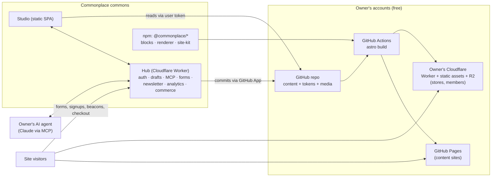
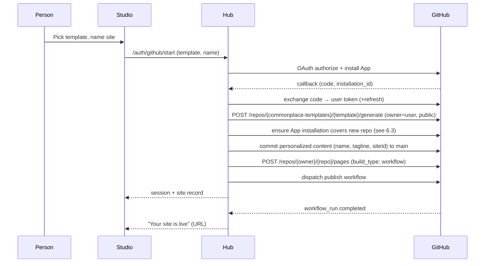

# Commonplace — Technical Architecture

| | |
|---|---|
| **Author** | Benjamin Life (@omniharmonic) |
| **Status** | Draft v0.1 |
| **Date** | October 26, 2026 |
| **Reads with** | [01 — PRD](01-PRD.md) · [03 — Implementation Plan](03-IMPLEMENTATION-PLAN.md) · [04 — Templates & Design System](04-TEMPLATES-AND-DESIGN-SYSTEM.md) |

---

## 1. System at a glance

Commonplace has four moving parts:

1. **Site repositories** — one per website, in the owner's GitHub account. Holds content as JSON/Markdoc, design tokens and media, plus a thin Astro shell that depends on a versioned package (`@commonplace/site-kit`). A GitHub Actions workflow builds and publishes it.
2. **Studio** — the visual editor. A static single-page app (React + Vite) that renders the *same* block components the published site uses, inside a canvas frame.
3. **The Hub** — one shared service on Cloudflare Workers (with D1, R2, KV, Durable Objects, Queues). It brokers GitHub sign-in, hosts the MCP server, coordinates live drafts, and provides the dynamic features static sites can't: forms, newsletters, analytics, members, commerce webhooks, scheduled publishing and template updates.
4. **Deploy targets** — GitHub Pages (default, content sites) or the owner's own Cloudflare account (stores, member areas, password pages).



### 1.1 Architectural decisions (summary)

| # | Decision | Rationale |
|---|---|---|
| ADR-1 | **Static-first output with Astro 6** | Free hosting, speed, durability; Astro is the content-site standard and is now Cloudflare-backed |
| ADR-2 | **Edit structured JSON, never raw HTML** | Lets humans and agents make precise changes without breaking layouts; enables migrations |
| ADR-3 | **One React component library renders both the editor canvas and production HTML** | Guaranteed WYSIWYG fidelity. Production pages ship zero React runtime |
| ADR-4 | **One public repo per site in the owner's account** | Ownership, portability, free Pages and Actions |
| ADR-5 | **Thin site repo + versioned `site-kit` package** | Improvements flow to every site through update PRs; "eject" remains possible |
| ADR-6 | **Draft branch + per-site Durable Object "draft room"; squash on publish** | Live agent edits, future real-time collaboration, clean history |
| ADR-7 | **Shared Hub on Cloudflare Workers + D1 + R2 + DO** | Near-zero marginal cost per site; self-hostable via Deploy to Cloudflare |
| ADR-8 | **Two deploy targets** (GitHub Pages, owner's Cloudflare) | GitHub Pages terms exclude commerce and sensitive transactions |
| ADR-9 | **MCP with typed, schema-validated operations; bring-your-own AI** | Safe agent edits; the commons never pays for inference |
| ADR-10 | **Puck (MIT) as the editor shell, extended with a custom Grid section** — pending Spike S2 | Mature drag/drop, fields, outline, iframe viewports; fallback: own shell on dnd-kit |
| ADR-11 | **Design tokens in W3C DTCG format; colors generated in OKLCH** | Interoperable tokens; perceptually even palettes with guaranteed contrast |
| ADR-12 | **Rich text as ProseMirror JSON; long-form posts as Markdoc** | Lossless, validated block text; portable, safe posts without arbitrary JS |
| ADR-13 | **Store one optimized master image in the repo; generate variants at build** | Small repos, responsive output, cached builds |

---

## 2. The site repository

### 2.1 Layout

```
my-site/
├─ commonplace.json            # site id, hub URL, deploy target, template, schemaVersion, base path
├─ content/
│  ├─ site.json                # title, nav, header, footer, SEO defaults, integrations
│  ├─ styles.json              # design tokens (DTCG) + Site Styles selections
│  ├─ pages/
│  │  ├─ home.json
│  │  ├─ about.json
│  │  └─ services/index.json   # folders mirror URL structure
│  ├─ collections/
│  │  ├─ blog/
│  │  │  ├─ _collection.json   # list settings, layouts, taxonomy
│  │  │  └─ 2026-10-26-opening-day.mdoc
│  │  ├─ events/…
│  │  └─ products/…            # public catalog only (Phase 5)
│  └─ presets/                 # site-specific saved sections
├─ media/                      # master images ≤ 2400px long edge, metadata stripped
│  └─ 2026/10/hero-k3f9.jpg
├─ src/                        # thin Astro shell generated from the starter
│  ├─ pages/[...slug].astro
│  └─ overrides/               # optional custom blocks / CSS (Advanced)
├─ public/                     # favicon, CNAME, static files
├─ astro.config.mjs            # imports commonplace() integration from site-kit
├─ package.json                # "@commonplace/site-kit": "^1.4.0"
├─ AGENTS.md                   # how agents should edit this site
└─ .github/workflows/publish.yml
```

The repo stays small and readable. Nearly all code lives in versioned npm packages; the repo holds the owner's *content and choices*.

### 2.2 `commonplace.json`

```json
{
  "$schema": "https://schema.commonplace.dev/v1/site-config.json",
  "siteId": "st_01JB3Q8W2N",
  "schemaVersion": 3,
  "template": { "id": "meadow", "version": "1.2.0" },
  "hub": "https://hub.commonplace.dev",
  "deploy": {
    "target": "github-pages",
    "url": "https://maya.github.io/maya-yoga",
    "customDomain": null
  },
  "features": { "forms": true, "newsletter": true, "analytics": true, "search": false }
}
```

`site-kit` derives Astro's `site` and `base` from `deploy` — project sites served at `user.github.io/repo` need `base: "/repo"`, which flips to `/` when a custom domain is connected. Handling this automatically removes the most common GitHub Pages breakage.

### 2.3 `AGENTS.md`

Generated from the schema package, so it's always accurate. It tells any coding agent:

- Content lives in `content/`; never hand-edit `src/` unless asked for a custom block.
- Every block and section has a stable `id`; preserve ids when editing.
- Valid block types and fields (summarized, with a link to the full JSON Schema).
- Run `npx commonplace check` before committing; it validates schemas, links, image references and size budgets.
- Styles change through `content/styles.json` tokens, not inline CSS.
- How to run locally (`npm run dev`) and the local MCP server (`npx commonplace mcp`).

---

## 3. Content model

All content is validated by Zod schemas in `@commonplace/schema`, which also emit JSON Schema (for agents and external tools) and TypeScript types.

### 3.1 Identity and versioning

- Every page, section and block has a stable, collision-resistant id (`sec_…`, `blk_…`, 10-char base32). IDs make three-way merges, agent targeting and comments reliable.
- `schemaVersion` at the site level; `version` on each block type. Migrations are pure functions `(oldData) => newData`, run by `commonplace migrate`, by the Hub update bot, and lazily in Studio on load.

### 3.2 Page document

```json
{
  "id": "pg_home",
  "title": "Home",
  "slug": "",
  "seo": { "title": null, "description": "Slow, grounded yoga in Boulder.", "image": "media/2026/10/hero-k3f9.jpg" },
  "header": { "variant": "transparent-on-hero" },
  "sections": [
    {
      "id": "sec_7hq2",
      "preset": "hero/split-image@2",
      "layout": { "mode": "stack", "columns": { "d": [7, 5], "m": [12] }, "align": "center" },
      "style": {
        "colorTheme": "light-accent",
        "padding": { "d": "xl", "m": "lg" },
        "minHeight": { "d": "80vh" },
        "background": { "type": "none" }
      },
      "blocks": [
        { "id": "blk_a1", "type": "text", "v": 3, "column": 0,
          "fields": { "content": { "type": "doc", "content": [ "…ProseMirror JSON…" ] }, "preset": "display" } },
        { "id": "blk_a2", "type": "button", "v": 1, "column": 0,
          "fields": { "label": "Book a class", "link": { "type": "page", "page": "pg_schedule" }, "variant": "primary" } },
        { "id": "blk_a3", "type": "image", "v": 2, "column": 1,
          "fields": { "src": "media/2026/10/hero-k3f9.jpg", "alt": "Maya in a seated twist by a window", "focal": [0.42, 0.35], "aspect": "4:5" },
          "style": { "radius": "lg" } }
      ]
    },
    {
      "id": "sec_9bz1",
      "layout": {
        "mode": "grid",
        "rows": { "d": 16, "m": 22 },
        "items": {
          "blk_c1": { "d": { "x": 1, "y": 1, "w": 10, "h": 8 }, "m": { "x": 1, "y": 1, "w": 8, "h": 9 } },
          "blk_c2": { "d": { "x": 9, "y": 5, "w": 14, "h": 10, "z": 2 }, "m": { "x": 1, "y": 10, "w": 8, "h": 8 } }
        }
      },
      "style": { "colorTheme": "dark" },
      "blocks": [ "…" ]
    }
  ]
}
```

**Responsive values** use `{ "d": …, "t": …, "m": … }` (desktop / tablet / mobile). Authoring is desktop-first because that matches how people design; the compiled CSS is mobile-first. A missing breakpoint inherits from the next larger one (`m` ← `t` ← `d`).

### 3.3 Sections and layout modes

**Stack mode** — blocks in columns (1–4), with per-breakpoint column ratios and stacking order. Gaps and alignment come from tokens. It's impossible to misalign, so it's the default for presets and for Editor-role users.

**Grid mode** — the Fluid-Engine-equivalent:

- 24 columns on desktop/tablet, 8 on mobile, placed within a content-width track with full-bleed tracks on either side (blocks can bleed to the viewport edge).
- Rows have a token-defined unit height (`--cp-row-unit`, e.g. 24px desktop / 20px mobile) and use `minmax(unit, auto)`, so **rows grow to fit text instead of clipping** — fixing the tablet overflow problem Squarespace users hit.
- `z` for layering; overlap is allowed and flagged by an accessibility lint if text overlaps text.
- **Independent mobile layout.** If `m` placements are absent, Studio auto-generates them by **visual reading order** (top-to-bottom, then left-to-right on the desktop grid), not insertion order — a common Fluid Engine complaint. Once edited, mobile placements are stored and preserved.
- Tablet inherits desktop placements; an optional `t` override exists for precise work.

Compiled CSS (simplified):

```css
.cp-grid {
  display: grid;
  grid-template-columns:
    [full-start] minmax(var(--cp-gutter), 1fr)
    [content-start] repeat(24, minmax(0, calc(var(--cp-content-max) / 24)))
    [content-end] minmax(var(--cp-gutter), 1fr) [full-end];
  grid-auto-rows: minmax(var(--cp-row-unit), auto);
  column-gap: var(--cp-grid-gap);
}
.cp-grid > [data-cp-item] {
  grid-column: calc(var(--x) + 1) / span var(--w);
  grid-row: var(--y) / span var(--h);
  z-index: var(--z, 1);
}
@media (max-width: 767px) {
  .cp-grid { grid-template-columns: [full-start] var(--cp-gutter) [content-start] repeat(8, 1fr) [content-end] var(--cp-gutter) [full-end]; }
  .cp-grid > [data-cp-item] { grid-column: calc(var(--mx) + 1) / span var(--mw); grid-row: var(--my) / span var(--mh); }
}
```

Per-item placements are emitted as inline custom properties (`style="--x:1;--y:1;--w:10;--h:8;--mx:…"`), keeping the stylesheet shared and cacheable. "Bleed" items use `full-start`/`full-end` lines instead of numeric columns.

### 3.4 Site document (`site.json`)

Holds title, logo, favicon, navigation tree (pages, folders, external links, buttons), header variant and options (sticky, transparent-on-hero, mobile menu style), footer (a Grid section), announcement bar, social profiles, default SEO, locale, and integration settings (analytics on/off, booking provider URL, Stripe connection flag). No secrets — ever. `commonplace check` fails if anything resembling a key appears in `content/`.

### 3.5 Rich text

Stored as ProseMirror JSON with a constrained schema: paragraphs, headings mapped to *typography presets* (display, h1–h4, lead, body, small, eyebrow), bold, italic, underline, strikethrough, link, inline code, bullet/numbered lists, blockquote, highlight (token color), and hard breaks. No arbitrary inline styles. The MCP tools accept and return Markdown for convenience and convert losslessly within that schema.

### 3.6 Collections

Long-form items (blog posts, events, projects, products, episodes) are **Markdoc** files with typed frontmatter:

```markdoc
---
title: Opening day at the new studio
date: 2026-10-26
author: maya
categories: [news]
tags: [studio, boulder]
image: media/2026/10/studio-open.jpg
excerpt: We're in. Here's what the first week looks like.
status: published   # draft | scheduled | published
publishAt: null
---

We're finally in the new space on Pearl Street…



See the schedule
```

Markdoc tags map 1:1 to blocks, so posts can include any block without allowing arbitrary JavaScript. Studio provides a block-based post editor; agents can write the file directly. Each collection's `_collection.json` defines list layouts, item page layout (a page template with a content slot), taxonomies and feed settings.

---

## 4. Blocks, renderer and site-kit

### 4.1 Block definitions

```tsx
// packages/blocks/src/testimonial/index.tsx
import { defineBlock, f } from "@commonplace/schema";

export default defineBlock({
  type: "testimonial",
  version: 2,
  category: "social-proof",
  label: "Testimonial",
  fields: {
    quote:  f.richText({ marks: ["bold", "italic"], maxLength: 600 }),
    name:   f.text({ maxLength: 80 }),
    role:   f.text({ optional: true }),
    photo:  f.image({ optional: true, aspect: "1:1" }),
    rating: f.number({ min: 0, max: 5, optional: true }),
  },
  variants: ["card", "large", "minimal"],
  styleSlots: ["colorTheme", "padding", "radius", "border", "typography.quote", "align"],
  defaults: { variant: "card", name: "Alex Rivera", quote: "…" },
  render: ({ fields, variant, style }) => (
    <figure className={cx("cp-testimonial", `is-${variant}`)} data-cp-style={style}>
      <blockquote><RichText doc={fields.quote} /></blockquote>
      <figcaption>
        {fields.photo && }
        <span className="cp-name">{fields.name}</span>
        {fields.role && <span className="cp-role">{fields.role}</span>}
      </figcaption>
    </figure>
  ),
  ai: {
    purpose: "A short quote from a client or customer, attributed to a named person.",
    whenToUse: "Social proof near a call to action or on a services page.",
    avoid: "Inventing testimonials. Ask the owner for real quotes.",
  },
  migrate: { 1: (v1) => ({ ...v1, rating: undefined }) },
});
```

Field types: `text`, `richText`, `image`, `media` (video/audio), `link` (page, collection item, URL, email, phone, file, anchor), `select`, `boolean`, `number`, `color` (token reference), `list` (repeatable group), `reference` (collection items with filters), `form` (form schema), `embed` (sanitized URL or code).

The registry drives three consumers from one definition: **the renderer** (HTML), **Studio** (fields, panels, menus, defaults) and **MCP** (tool schemas and AI guidance).

### 4.2 Rendering without shipping React

Blocks are React components used only for **server-side rendering at build time** (Astro with `@astrojs/react`) and for the **Studio canvas**. Published pages ship no React runtime.

Interactivity is handled by **behaviors**: tiny vanilla TypeScript modules attached by data attributes (`data-cp-behavior="carousel"`). Astro bundles only the behaviors a page uses. Planned behaviors: `carousel`, `lightbox`, `accordion` (enhances native `<details>`), `tabs`, `marquee`, `reveal` (scroll animations via IntersectionObserver, honoring `prefers-reduced-motion`), `menu` (mobile nav), `popup`, `announcement`, `form` (async submit + validation), `newsletter`, `cart` (Phase 5), `video-lite`, `search` (Pagefind UI, lazy-loaded). Each behavior has a size budget (≤ 3 KB gzipped, cart ≤ 12 KB).

### 4.3 Images

Astro's `<Picture>` is an Astro component and can't run inside React render functions, so `site-kit` runs an **image resolution pass** before rendering a page:

1. Walk the page document and collect every image reference (`media/...`).
2. Call Astro's `getImage()` for each needed width/format (AVIF + WebP + JPEG fallback; widths chosen from the block's declared `sizes` and the layout).
3. Pass a resolved map `{ src → { srcset, width, height, placeholder } }` into the React render via context. `` reads from it.

Build-time image work is cached between runs (Actions cache of Astro's cache directory keyed on `media/**`), so only new images are processed. Each image also gets a tiny blurred placeholder (inline, < 300 bytes) and stored dimensions to prevent layout shift.

### 4.4 `site-kit` (Astro integration)

`@commonplace/site-kit` exports `commonplace()` for `astro.config.mjs`. It:

- Registers routes for all pages and collections from `content/` (Astro content collections with JSON and Markdoc loaders).
- Compiles `styles.json` tokens into CSS custom properties and the base stylesheet.
- Runs the image resolution pass and the renderer.
- Generates sitemap, robots.txt, RSS/Atom/iCal/podcast feeds, structured data (JSON-LD), redirects, and social share images (Satori + resvg at build).
- Runs Pagefind after build when search is on.
- Injects behaviors, the analytics beacon (if enabled) and form endpoints configured for the site's Hub.
- In Cloudflare-target mode, switches to the Cloudflare adapter with `prerender: true` everywhere except dynamic routes (members, cart APIs).

---

## 5. Studio (the editor)

### 5.1 Stack

| Concern | Choice |
|---|---|
| App | React 19 + Vite, TypeScript, PWA (installable, offline drafts) |
| Editor shell | Puck (MIT core) — page outline, component menu, fields, drag-to-reorder, iframe viewports. Pending Spike S2 |
| Grid section editing | Custom canvas overlay (pointer events + dnd-kit) with snapping, resize handles, smart guides, keyboard nudging |
| Inline text | Tiptap (ProseMirror) mounted over text blocks in the canvas, schema-matched to §3.5 |
| State | Zustand store holding the document; all mutations via the `@commonplace/ops` operation format (Immer patches under the hood) |
| Local persistence | IndexedDB (drafts, media queue, op log) |
| Data | GitHub REST/GraphQL for reads; Hub draft room (WebSocket) for writes |
| Styling | Studio's own UI uses Radix primitives + its own token CSS; never leaks into the canvas |

### 5.2 Canvas

The canvas is an iframe loading `site-kit`'s runtime stylesheet, the site's compiled tokens, fonts and behaviors, and rendering the same block components through the renderer. This is what guarantees the canvas matches production.

Security: the canvas is same-origin (needed for drag/drop and inline editing), so **owner-authored code never executes in it**. Code/embed blocks render inside nested `sandbox`ed iframes (`srcdoc`, scripts allowed, *no* `allow-same-origin`); head/footer code injection shows as a placeholder. A separate **Preview** tab, served from an isolated origin with no credentials, runs the page with all custom code for true-to-life checking.

### 5.3 Operations and the draft room

Every edit — from a human in Studio or an agent via MCP — is an **operation** in a small, typed vocabulary:

```ts
type Op =
  | { op: "block.update"; page: Id; block: Id; set: Partial<Fields>; }
  | { op: "block.insert"; page: Id; section: Id; at: Position; block: Block }
  | { op: "block.move";   page: Id; block: Id; to: { section: Id; at: Position } }
  | { op: "block.delete"; page: Id; block: Id }
  | { op: "grid.place";   page: Id; section: Id; block: Id; bp: "d" | "t" | "m"; rect: Rect }
  | { op: "section.insert" | "section.move" | "section.delete" | "section.update"; … }
  | { op: "styles.patch"; patch: TokenPatch }
  | { op: "page.create" | "page.update" | "page.delete"; … }
  | { op: "nav.update"; tree: NavTree }
  | { op: "media.add"; path: string; meta: MediaMeta }
  | { op: "collection.upsert" | "collection.delete"; … };
```

Operations are validated against the schema before they're accepted, are invertible (for undo), and are mergeable because they target stable ids.

**Draft room.** Each site has a Durable Object in the Hub (`DraftRoom(siteId)`) that is the authoritative, ordered log of draft operations while anyone is editing:

1. Studio opens a WebSocket to the room, receives the current draft head and any ops since.
2. Studio applies ops optimistically, sends them to the room; the room validates, orders and broadcasts them to all connected clients (other tabs, collaborators, and the "Claude is editing…" presence).
3. MCP tool calls become ops submitted to the same room.
4. The room persists ops in its own SQLite storage immediately and **flushes a commit to the `cp/draft` branch** after 10 seconds of idle or 50 ops, whichever first, using a GitHub App installation token. Commits carry a `Co-authored-by:` trailer for the human (and an `Agent:` trailer for MCP sessions).
5. When nobody is connected, the room hibernates (Durable Object hibernation keeps idle cost near zero).

**Offline / Hub-down mode.** Studio queues ops in IndexedDB. If the Hub is unreachable for > 30 seconds, it can commit directly to `cp/draft` with the user token via GraphQL `createCommitOnBranch` (with `expectedHeadOid` for optimistic concurrency) and reconcile when the room returns.

**Conflict handling.** Ops on different ids commute. Same-field concurrent edits resolve last-writer-wins at field level with a visible "Ana changed this too" toast and one-click restore of the other version. Text uses field-level LWW at MVP; Phase 6 upgrades rich text to Yjs CRDTs inside the same room for true co-editing.

### 5.4 Commits, publishing and history

- **Small changes** (text JSON): GraphQL `createCommitOnBranch` (atomic multi-file commit).
- **Media batches**: Git Data API — create blobs → tree → commit → update ref — which handles larger binary payloads and many files at once.
- **Publish**: the Hub (a) flushes the room, (b) creates a single squash commit on `main` whose tree equals `cp/draft`'s tree, with a human-readable message generated from the op log ("Edited Home and About; added 2 images; changed accent color"), (c) resets `cp/draft` to the new `main`. The push to `main` triggers the publish workflow.
- **History**: every commit on `main` is a published version. Studio lists them as a timeline (date, author, summary, thumbnail captured after deploy). Named snapshots are lightweight tags (`cp/snap/…`), created automatically before agent sessions and template updates.
- **Rollback**: a new commit on `main` with the tree of the chosen version. Never a force-push; history stays intact.
- **Scheduled publish**: stored in D1 (`schedules`), executed by a Hub cron trigger that runs the same publish routine.

### 5.5 Build status

The GitHub App subscribes to `workflow_run` webhooks. The Hub maps run status to the site and pushes it through the draft room to Studio: *Publishing… → Live* (with URL) or *Couldn't publish* with a translated error. Common failures have automated fixes ("an image is too large — compress and retry"; "a page references a deleted image — remove reference"). As a last resort, "Undo last publish" rolls back.

### 5.6 Media pipeline (in browser)

1. Accept drag/drop, paste, file picker, phone camera.
2. Decode with `createImageBitmap`; downscale so the long edge ≤ 2400px; re-encode (JPEG q≈85 for photos, PNG/WebP lossless for graphics with alpha). Re-encoding **strips all EXIF, including GPS**.
3. Compute dominant color, blur placeholder and dimensions; suggest a focal point (simple saliency heuristic; editable).
4. Name files `media/YYYY/MM/<slug>-<hash>.<ext>`; dedupe by content hash.
5. Queue in IndexedDB; upload as a blob batch; emit `media.add` ops.
6. A repo-size meter warns at 600 MB and blocks uploads at 900 MB (GitHub Pages' published-site limit is 1 GB), with guidance to move video/large files to the Cloudflare target's R2.

SVGs are sanitized (DOMPurify SVG profile) before commit. Video uploads are only offered on the Cloudflare target (stored in the owner's R2); otherwise Studio steers to YouTube/Vimeo/PeerTube embeds rendered as lite embeds.

### 5.7 Mobile Studio

Phones get a purpose-built layout: page list → section list → tap to edit content in a bottom sheet, reorder sections by drag, replace images from camera roll, publish. Grid placement editing is hidden on phones (tablet and up only).

---

## 6. GitHub integration

### 6.1 The Commonplace GitHub App

| Permission | Level | Used for |
|---|---|---|
| Contents | Read & write | Content commits, branches, tags |
| Workflows | Read & write | Updating `publish.yml` during template/kit updates |
| Pages | Read & write | Enabling Pages, custom domains, HTTPS |
| Actions | Read | Build status, logs for error translation |
| Administration | Read & write | Creating site repos for the user; repo settings |
| Secrets | Read & write | Writing Cloudflare deploy credentials as encrypted Actions secrets (write-only in practice) |
| Pull requests | Read & write | Kit/template update PRs |
| Metadata | Read | Required |
| Account: Email addresses | Read | Notifications |

Webhooks: `installation`, `installation_repositories`, `github_app_authorization` (revocation), `workflow_run`, `push` (to detect outside edits and refresh drafts).

User tokens follow GitHub's App model: access tokens expire after 8 hours and are renewed with refresh tokens. The Hub stores refresh tokens encrypted (AES-GCM, key in Workers secrets) and hands Studio short-lived access tokens kept only in memory.

### 6.2 Onboarding sequence



### 6.3 Spike S1 — the permission puzzle

The unknown: whether a single authorize-and-install step can both create a new repo in the user's account *and* leave the App installed on that repo for later server-side commits (draft room flushes, scheduled publishes, update PRs) when the user chose "Only select repositories."

Options, in preference order (Spike S1 decides):

1. **App installed on "All repositories"** with honest copy ("Commonplace only touches repositories it creates"). Simplest; some people will balk.
2. **Create first, then scoped install**: create the repo with the user token, then send the person to the App's installation page pre-filtered to that repo. One extra click.
3. **Per-repo installation from a template org**: generate under a Commonplace org and transfer to the user (transfer requires acceptance — likely too much friction).
4. **Fallback OAuth App** with `public_repo` + `workflow` scopes (no installation tokens; server-side work uses the stored user token). Broadest scopes; simplest flow; least preferred for security.

Whatever the result, the rest of the system depends only on a `GitHubAccess` interface (`commit`, `branch`, `pages`, `secrets`, `workflowStatus`), so the choice is isolated.

### 6.4 Collaborators

Inviting a collaborator adds them as a GitHub repo collaborator (write) and records a Commonplace role in D1. Roles are enforced by the Hub (it rejects ops outside a role's allowance — e.g., Editors can't emit `styles.patch` or `grid.place` on locked sections). Because collaborators have Git write access, a technical collaborator could bypass roles by pushing directly; that's acceptable (they're trusted with the repo) and documented. Invitees without GitHub accounts get the same guided sign-up as owners.

### 6.5 Rate limits

User tokens and installation tokens each have their own GitHub API budgets. Studio reads through the draft room and conditional requests (ETags) to stay well within limits; commit batching (10-second idle flush) keeps write volume low. The Hub tracks per-installation usage and backs off before limits.

---

## 7. Build and deploy

### 7.1 GitHub Pages target (default)

```yaml
# .github/workflows/publish.yml (generated; managed by site-kit updates)
name: Publish
on:
  push: { branches: [main] }
  workflow_dispatch:
permissions: { contents: read, pages: write, id-token: write }
concurrency: { group: publish, cancel-in-progress: true }
jobs:
  build:
    runs-on: ubuntu-latest
    steps:
      - uses: actions/checkout@v4
      - uses: actions/setup-node@v4
        with: { node-version: 22, cache: npm }
      - uses: actions/cache@v4
        with:
          path: node_modules/.astro
          key: cp-assets-${{ hashFiles('media/**') }}
          restore-keys: cp-assets-
      - run: npm ci
      - run: npx commonplace check --ci      # schema, links, budgets, secret scan
      - run: npm run build                   # astro build (+ pagefind, og images)
      - uses: actions/upload-pages-artifact@v3
        with: { path: dist }
  deploy:
    needs: build
    runs-on: ubuntu-latest
    environment: { name: github-pages, url: "${{ steps.d.outputs.page_url }}" }
    steps:
      - id: d
        uses: actions/deploy-pages@v4
```

(Action versions pinned to the current majors at implementation time.)

Facts that shaped this: GitHub Pages is free for public repositories; published sites are capped at 1 GB; deployments time out after 10 minutes; the soft limit of 10 builds per hour does not apply to custom Actions workflows like this one. Actions minutes on standard runners are free for public repositories.

**Build-time budget**: target < 90s for a 20-page site with 100 images on a warm cache. Levers: npm cache, Astro asset cache, skipping OG image regeneration for unchanged pages (content-hash manifest), and Pagefind's fast indexing.

### 7.2 Cloudflare target

For stores, member areas and password-protected pages. The site deploys as a **Worker with static assets** in the owner's own Cloudflare account; prerendered pages are served as static assets, and a small Worker handles dynamic routes.

Connection flow (Studio → Settings → "Upgrade to Cloudflare hosting"):

1. Guided Cloudflare sign-up (free plan) in a new tab.
2. Studio deep-links to Cloudflare's API-token creation page with a pre-filled template (Workers Scripts edit, R2 edit, D1 edit for this account only). The person copies the token back.
3. Studio encrypts the token with the repo's Actions public key (libsodium sealed box) and writes `CLOUDFLARE_API_TOKEN` and `CLOUDFLARE_ACCOUNT_ID` as **repo Actions secrets** — the Hub never stores it.
4. The workflow's deploy job switches to `wrangler deploy` (assets from `dist/`, Worker from `site-kit`'s Cloudflare entry) and provisions the site's R2 bucket and D1 database on first run.
5. Domains move with a guided DNS change.

Static asset requests on Workers are free; dynamic requests fall under the owner's free plan (100,000 requests/day), ample for small stores and member sites.

### 7.3 Custom domains

The wizard:

1. Looks up the domain's registrar via RDAP and shows registrar-specific instructions (top registrars illustrated).
2. GitHub Pages: writes `public/CNAME`, calls the Pages API to set the domain, shows the four apex A records + `www` CNAME. Cloudflare target: adds a custom domain to the Worker (domain on Cloudflare DNS, or a CNAME setup).
3. Polls DNS through DNS-over-HTTPS every 15 seconds with a live checklist ("✓ www points to GitHub — waiting for the main domain").
4. Enables "Enforce HTTPS" once the certificate is issued; updates `commonplace.json` (which flips the Astro `base` to `/`) and republishes.

---

## 8. The Hub

### 8.1 Composition

One Cloudflare Workers project (Hono router), deployable with a single "Deploy to Cloudflare" button for anyone who wants to self-host.

| Binding | Use |
|---|---|
| **D1** (`HUB_DB`) | Users, sites, roles, forms, submissions, subscribers, campaigns, members, orders, schedules, audit log |
| **Durable Objects** | `DraftRoom` (per site), `McpSession` (per MCP connection, via the Agents SDK), `RateLimiter` |
| **KV** | OAuth provider state for MCP, short-lived caches (read-heavy only — KV writes are scarce on the free plan) |
| **R2** | Form file uploads, campaign assets, gated content for Hub-hosted member features, exports |
| **Queues** | Email sends, campaign fan-out, webhook processing, update-PR generation |
| **Analytics Engine** | Pageview/event datapoints for site analytics |
| **Cron Triggers** | Scheduled publishes (every minute), campaign scheduling, kit-update checks (daily), retention purges (daily), analytics rollups (hourly) |
| **Email Service** | Transactional mail from the Hub domain: magic links, opt-in confirmations, form notifications |
| **Turnstile** | Bot protection for public endpoints |

### 8.2 Routes

```
Auth
  GET  /auth/github/start            → GitHub authorize (+ install)
  GET  /auth/github/callback
  POST /auth/token                   → short-lived GitHub user token for Studio (session cookie)
  POST /auth/logout

Sites
  POST /api/sites                    → create from template
  GET  /api/sites                    → list (owner + collaborator)
  PATCH/DELETE /api/sites/:id
  POST /api/sites/:id/publish        → flush draft room, squash to main
  POST /api/sites/:id/rollback
  POST /api/sites/:id/schedule
  GET  /api/sites/:id/room           → WebSocket upgrade to DraftRoom

Public (called from published sites; CORS allowlist = site domains)
  POST /f/:siteId/:formId            → form submission (HTML POST or fetch)
  POST /n/:siteId/subscribe          → newsletter signup
  GET  /n/confirm/:token · /n/unsubscribe/:token
  POST /a/:siteId                    → analytics beacon
  POST /c/:siteId/checkout           → create Stripe Checkout Session (Phase 5)
  POST /c/stripe/webhook

Members (Phase 4)
  POST /m/:siteId/login              → send magic link
  GET  /m/:siteId/verify/:token      → issue signed member token, redirect to site

MCP
  POST /mcp                          → Streamable HTTP MCP endpoint
  GET  /.well-known/oauth-authorization-server
  GET  /authorize · POST /token · POST /register

GitHub
  POST /webhooks/github
```

### 8.3 Data model (D1, abridged)

```sql
CREATE TABLE users        (id TEXT PRIMARY KEY, github_id INTEGER UNIQUE, login TEXT, email TEXT,
                           refresh_token_enc BLOB, created_at INTEGER);
CREATE TABLE sites        (id TEXT PRIMARY KEY, owner_id TEXT, repo TEXT, installation_id INTEGER,
                           deploy_target TEXT, domain TEXT, plan_flags TEXT, created_at INTEGER);
CREATE TABLE site_roles   (site_id TEXT, user_id TEXT, role TEXT, locked_sections TEXT,
                           PRIMARY KEY (site_id, user_id));
CREATE TABLE forms        (id TEXT, site_id TEXT, schema_hash TEXT, notify TEXT, PRIMARY KEY (site_id, id));
CREATE TABLE submissions  (id TEXT PRIMARY KEY, site_id TEXT, form_id TEXT, data_json TEXT,
                           files TEXT, spam_score REAL, created_at INTEGER, purge_at INTEGER);
CREATE TABLE subscribers  (id TEXT PRIMARY KEY, site_id TEXT, email TEXT, status TEXT, tags TEXT,
                           confirmed_at INTEGER, source TEXT, UNIQUE (site_id, email));
CREATE TABLE campaigns    (id TEXT PRIMARY KEY, site_id TEXT, subject TEXT, body_json TEXT,
                           status TEXT, send_at INTEGER, stats_json TEXT);
CREATE TABLE members      (id TEXT PRIMARY KEY, site_id TEXT, email TEXT, tier TEXT,
                           stripe_customer TEXT, status TEXT, UNIQUE (site_id, email));
CREATE TABLE inventory    (site_id TEXT, sku TEXT, qty INTEGER, PRIMARY KEY (site_id, sku));
CREATE TABLE orders       (id TEXT PRIMARY KEY, site_id TEXT, stripe_session TEXT, status TEXT,
                           total INTEGER, currency TEXT, items_json TEXT, shipping_json TEXT, created_at INTEGER);
CREATE TABLE schedules    (id TEXT PRIMARY KEY, site_id TEXT, kind TEXT, run_at INTEGER, payload TEXT, status TEXT);
CREATE TABLE audit_log    (id TEXT PRIMARY KEY, site_id TEXT, actor TEXT, action TEXT, meta TEXT, at INTEGER);
```

Partitioning: start with one D1 database; every table is keyed by `site_id`, so sharding by `site_id` hash across multiple databases is a mechanical change when size or throughput requires it.

### 8.4 Quotas (public Hub defaults)

| Resource | Per-site default | Notes |
|---|---|---|
| Form submissions | 1,000 / month | Spam doesn't count |
| Stored submissions | 12 months | Configurable shorter |
| Subscribers | 5,000 | Raise on request |
| Campaign sends | Via owner's sender (see 9.2) | Hub doesn't pay for marketing email |
| Transactional emails | 500 / month | Opt-in confirmations, notifications, magic links |
| Analytics pageviews | 300,000 / month, then sampled | |
| File uploads (forms) | 1 GB total | |
| MCP operations | 2,000 / day | |

Self-hosted Hubs set their own limits.

### 8.5 Cost model

On Cloudflare's Workers Paid plan ($5/month base, which includes 10 million requests/month), estimated load per 1,000 active sites/month:

| Driver | Volume | Est. cost |
|---|---|---|
| Analytics beacons (avg 3,000 pageviews/site) | 3M requests + 3M datapoints | within included requests; datapoints ≈ cents |
| Forms, signups, auth, Studio sessions | ~0.3M requests | included |
| Draft-room DO activity (hibernating) | low | cents |
| D1 storage | < 1 GB | included |
| Transactional email | ~50k messages | per-message pricing — the largest variable; monitor |

Target: **under $0.002 per active site per month**, i.e., a few dollars a month for thousands of sites. Budget alerts at 80% of allowances; analytics sampling is the first lever if costs rise.

---

## 9. Dynamic features

### 9.1 Forms

- The form block compiles to a real `<form method="post" action="https://hub…/f/:siteId/:formId">` (works with JavaScript off), enhanced by the `form` behavior for inline validation and async submit.
- The Hub validates against the form's schema (published with the site as `/_cp/forms.json` and cached by hash), runs Turnstile, rate-limits per IP and site, stores the entry, notifies the owner (batched digest option), and redirects back with `?cp_form=success` or returns JSON.
- File uploads go directly to R2 via presigned URL with size/type limits.
- Studio's Inbox lists entries with search, mark-read, export, delete. Optional "send entries to Google Sheets" via the owner's own Google connection (Phase 6).

### 9.2 Newsletter and email campaigns

- Signup → double opt-in email from the Hub domain ("Confirm your subscription to Maya Yoga") → `subscribers.status = confirmed`.
- **Campaigns (Phase 4)** are composed in Studio from email-safe versions of the same blocks (`@commonplace/email-render` → table-based HTML), previewed on desktop/mobile/dark mode.
- **Sending uses the owner's own sender**, connected once: Cloudflare Email Service on their Cloudflare account, Resend, Postmark or Amazon SES. Free tiers of these cover typical small lists. This keeps the commons from subsidizing marketing email and protects deliverability (each sender reputation belongs to the sender). The connection guide verifies SPF/DKIM/DMARC on the owner's domain before first send.
- The Hub handles list management, scheduling, unsubscribe links (RFC 8058 one-click), bounces/complaints via provider webhooks, and basic stats (delivered, opened where available, clicked via redirect links).

### 9.3 Analytics

Cookieless, privacy-first. A ~1 KB beacon posts `{path, referrer, screen class, utm}`; the Hub derives a daily-rotating salted hash of IP + user agent for unique-visitor counts (never stored raw) and writes to Analytics Engine. Studio shows visits, top pages, sources, devices and form conversions. Owners can disable it or use their own (Cloudflare Web Analytics is a one-toggle option on the Cloudflare target).

### 9.4 Members (Phase 4; Cloudflare target)

Gated content must never be in the public repo. So:

- **Gated pages** are edited in Studio like any page but saved to the **owner's R2 bucket** (through the site Worker's authenticated admin endpoint), not to Git. Studio flags them with a lock icon.
- The site Worker server-renders gated routes (`/members/*`, `prerender = false`) using the same renderer, reading page JSON from R2, and checks a member session cookie.
- Login is passwordless: the Hub emails a magic link; the link lands on the site's own domain (`/_cp/auth/callback`), the Worker verifies the Hub-signed token against the Hub's published JWKS and sets an HTTP-only cookie on the site domain. No passwords pass through anything.
- Paid tiers are Stripe subscriptions (Phase 5) mapped to member tiers via webhook.
- Password-protected pages (Squarespace-style shared password) use the same gating with a shared secret hashed in the Worker's environment.

### 9.5 Commerce (Phase 5; Cloudflare target)

- **Catalog** (titles, descriptions, images, prices, variants, SKUs) is public content in `content/collections/products/`, rendered statically.
- **Stock** lives in D1 (`inventory`), shown on product pages via a tiny availability fetch, and enforced at checkout.
- **Cart** is a ≤12 KB behavior storing items in `localStorage`, with a slide-out drawer.
- **Checkout**: the cart posts SKUs and quantities to the Hub (or to the site Worker in sovereign mode). Prices are **re-read from the published catalog manifest**, never trusted from the browser. The Hub creates a Stripe Checkout Session on the owner's connected Stripe account (Stripe Connect, Standard accounts, **no application fee**), including shipping options, Stripe Tax (if enabled) and promotion codes.
- **Webhooks** (`checkout.session.completed`, refunds, subscription events) update orders, decrement stock, trigger digital delivery (signed R2 URLs emailed via Stripe receipts or the owner's sender) and member-tier changes.
- **Sovereign mode**: owners can skip Stripe Connect and store their own Stripe restricted key as a secret on their site Worker; then checkout and webhooks run entirely in their account.
- **Orders dashboard** in Studio: list, filter, mark fulfilled, print packing slip, refund (via Stripe API on the connected account).

### 9.6 Search

Pagefind indexes the built HTML in CI; the search UI loads on demand. No server, no cost.

### 9.7 Scheduling

Phase 2: a Booking block embedding the owner's Cal.com or Calendly page with lite-loading. (Cal.com is AGPL; its MIT-licensed community fork, Cal.diy, can be self-hosted by Hub operators who want a commons scheduler.) Phase 6 explores native simple booking (availability rules, Google Calendar free/busy via the owner's connection, Stripe deposits) on the Cloudflare target.

---

## 10. The MCP server

### 10.1 Transport and auth

- Remote MCP over Streamable HTTP at `https://hub…/mcp`, built with Cloudflare's Agents SDK (`McpAgent` on Durable Objects) and `workers-oauth-provider`.
- The Hub is the OAuth authorization server for MCP clients and an OAuth client of GitHub upstream: connecting Claude triggers a GitHub sign-in, then a Commonplace consent screen ("Allow Claude to edit: ☑ Maya Yoga ☐ Riverbend Collective · ☐ Allow publishing").
- Grants are per-site and revocable from Studio.

### 10.2 Tools

| Tool | Purpose |
|---|---|
| `list_sites` | Sites this grant covers |
| `get_site` | Settings, navigation, styles summary, page list |
| `get_page` | Section/block tree with ids, fields and layout (Markdown for rich text) |
| `list_blocks` | Block catalog: fields, variants, AI guidance (`purpose`, `whenToUse`, `avoid`) |
| `list_section_presets` | Presets by category with descriptions and thumbnails |
| `get_styles` / `set_styles` | Read/patch Site Styles tokens (validated, contrast-checked) |
| `insert_section` | From a preset or explicit section, at a position |
| `update_section` / `move_section` / `delete_section` | |
| `insert_block` / `update_block` / `move_block` / `delete_block` | Fields validated against block schema |
| `place_in_grid` | Grid placement per breakpoint |
| `create_page` / `update_page` / `delete_page` / `update_navigation` | |
| `upload_image` | From URL or base64; runs the same resize/strip pipeline server-side |
| `create_post` / `update_post` / `list_posts` | Collections |
| `get_draft_diff` | Human-readable summary of unpublished changes |
| `preview` | Returns preview URL; optional screenshot (Phase 2, via Browser Rendering, quota-limited) |
| `publish` | Requires `confirm: true` and the grant's publish permission |
| `discard_draft` / `rollback` | |

Resources: block JSON Schemas, the site's token set, `AGENTS.md`, the design guidance from doc 04 (so the agent composes with presets and tokens rather than inventing styles).

### 10.3 Safety

- Every tool call becomes validated ops in the DraftRoom — the same path as human edits. Invalid ops return precise errors the agent can correct.
- A snapshot tag is created at the start of each agent session; Studio's banner offers "Undo all of Claude's changes."
- Rate limits per grant; destructive tools (`delete_page`, `discard_draft`) require an explicit `confirm` parameter.
- Agents can't write to `src/`, workflows or `commonplace.json` through MCP.

### 10.4 Local MCP

`npx @commonplace/cli mcp` runs the same tool set against a local clone (stdio transport) for Claude Code users — no Hub required. Edits become file changes the person commits themselves.

---

## 11. Updates, templates and packages

### 11.1 Packages (npm, `@commonplace/*`)

| Package | Role | License |
|---|---|---|
| `schema` | Zod schemas, types, JSON Schema export, migrations | MIT |
| `ops` | Operation types, apply/invert/merge | MIT |
| `theme` | Token compiler, OKLCH palette generator, contrast solver, font pairings | MIT |
| `blocks` | Block library | MIT |
| `renderer` | Page/section/grid renderer, behaviors | MIT |
| `site-kit` | Astro integration | MIT |
| `email-render` | Blocks → email HTML | MIT |
| `mcp-tools` | Tool definitions shared by Hub and CLI | MIT |
| `cli` | `check`, `dev`, `migrate`, `mcp`, `eject` | MIT |

Semantic versioning; sites depend on `^major`. Breaking changes ship with migrations.

### 11.2 Update bot

Daily, the Hub checks each site's `site-kit` version against the latest compatible release. If newer:

1. Generates the change: bump versions, run migrations on `content/`, refresh managed files (`publish.yml`, `AGENTS.md`, starter shell).
2. Opens a PR titled "Commonplace update 1.5.0: new gallery layouts, faster builds".
3. Studio shows "Update available" with a plain-language changelog and a **preview** (the canvas renders with the PR's packages through a versioned CDN build of the renderer). One click merges; rollback is the usual rollback.

Security fixes can be marked auto-merge (owner opt-out).

### 11.3 Templates

A template is **content + styles + media**, not code: a set of page documents, `styles.json`, section presets and demo images (with licenses recorded). Templates live in `commonplace/templates/<name>` and are published as GitHub template repositories for creation. Switching templates on an existing site applies the new template's styles and presets while keeping content ("Try this look" → preview → apply), possible because content and presentation are separated by tokens and presets. Full details in doc 04.

### 11.4 Eject

`npx commonplace eject` copies the kit's source into the repo and removes the dependency, for people who want a plain Astro project. Studio continues to work only on un-ejected sites (it warns first).

---

## 12. Security and privacy model

| Threat | Control |
|---|---|
| Token theft from Studio | Tokens in memory only; 8-hour expiry; strict CSP; no third-party scripts in Studio; canvas never executes owner code; preview on an isolated, credential-free origin |
| Hub compromise exposing GitHub access | Refresh tokens encrypted at rest; installation tokens minted per operation (1-hour expiry); Cloudflare tokens never reach the Hub (Actions secrets only); audit log; key rotation runbook |
| Malicious template/preset contributions | Templates are data validated by schema; code (blocks) only via reviewed packages; SVG sanitization |
| Form spam / abuse | Turnstile, rate limits, honeypot, per-site quotas, content filters |
| Phishing sites built on the platform | Reporting + Hub service suspension; GitHub's own enforcement; no form fields of type "password" or "card number" allowed in the form builder |
| Checkout tampering | Server-side price lookup from published catalog manifest; webhook signature verification |
| Agent misuse | Per-site grants, publish permission off by default, schema validation, snapshots, rate limits |
| Private data leaking into public repos | Secret scanner in `commonplace check`; gated content routed to R2; Studio warnings on fields that look like personal data (phone numbers in non-contact blocks, etc.) |
| GDPR/CCPA | Data export and deletion per site and per subscriber/member; processor terms; EU visitors' analytics are cookieless |

---

## 13. Observability and operations

- **Hub**: Workers Logs + traces; error reporting to a self-hosted GlitchTip (or Sentry free tier); dashboards for request volume, D1 latency, DO counts, email sends, cost estimates.
- **Builds**: `workflow_run` failures aggregated by error class to find the top causes of failed publishes.
- **Studio**: opt-in error reporting and anonymous performance timings.
- **Status page** for the public Hub.
- **Runbooks**: GitHub outage (Studio read-only banner, queue ops), Cloudflare outage (published GitHub Pages sites unaffected; forms show fallback), key rotation, abuse response, data deletion requests.

---

## 14. Monorepo layout

```
commonplace/
├─ apps/
│  ├─ studio/            # Vite + React editor (AGPL-3.0)
│  ├─ hub/               # Cloudflare Workers (AGPL-3.0)
│  ├─ www/               # Marketing site + template gallery — built with Commonplace itself
│  └─ docs/              # Astro Starlight docs
├─ packages/
│  ├─ schema/  ops/  theme/  blocks/  renderer/  site-kit/  email-render/  mcp-tools/  cli/
├─ templates/
│  ├─ starter/           # the thin Astro shell
│  └─ meadow/ harbor/ atelier/ …   # see doc 04
└─ tools/
   ├─ visual-tests/      # Playwright screenshot matrix
   └─ fixtures/          # torture-test sites
```

Tooling: pnpm workspaces, Turborepo, TypeScript strict, Vitest, Playwright, Changesets for releases, Biome for lint/format.

---

## 15. References

- GitHub Pages limits and usage policy — https://docs.github.com/en/pages/getting-started-with-github-pages/github-pages-limits
- GitHub App user access tokens — https://docs.github.com/en/apps/creating-github-apps/authenticating-with-a-github-app/generating-a-user-access-token-for-a-github-app
- Puck visual editor (MIT) — https://github.com/puckeditor/puck · https://puckeditor.com/docs
- Webstudio (AGPL-3.0) — https://github.com/webstudio-is/webstudio
- Onlook (Apache-2.0) — https://github.com/onlook-dev/onlook
- Astro 6 and Cloudflare — https://www.infoq.com/news/2026/02/astro-v6-beta-cloudflare
- Cloudflare Workers limits and pricing — https://developers.cloudflare.com/workers/platform/limits · https://developers.cloudflare.com/workers/platform/pricing/
- Deploy to Cloudflare buttons — https://developers.cloudflare.com/workers/platform/deploy-buttons/
- Cloudflare Email Service — https://developers.cloudflare.com/changelog/post/2026-04-16-email-sending-public-beta/
- Remote MCP with GitHub OAuth on Workers (reference) — https://github.com/cloudflare/ai/tree/main/demos/remote-mcp-github-oauth
- Pagefind — https://pagefind.app
- Squarespace Fluid Engine — https://support.squarespace.com/hc/articles/6421525446541
- Cal.diy (MIT fork of Cal.com) — https://github.com/calcom/cal.diy

---

*Prepared by Benjamin Life (@omniharmonic).*
